  

  
  
  

---

### 📓 Ship's log

<!-- LOG:START -->
**Day 1839 of the voyage** · 4 November 2026

*Nothing on the long-range scanners but the usual dust. Nothing on the public frequencies. Some voyages are made in the dark. Logging off. The stars can keep watch.*
<!-- LOG:END -->

The ship's computer writes a new entry each morning from yesterday's public commits. <a href="logbook.md">Read the whole logbook →</a>

### 🛠️ Stack

  

### 📊 GitHub stats

  

  
  

